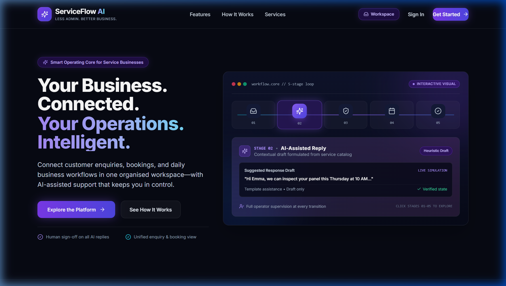
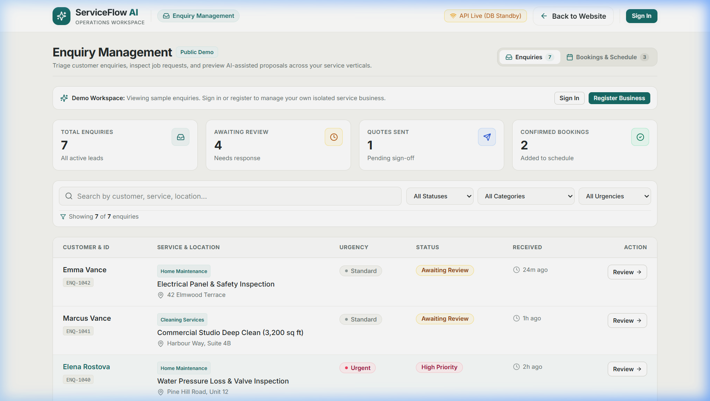
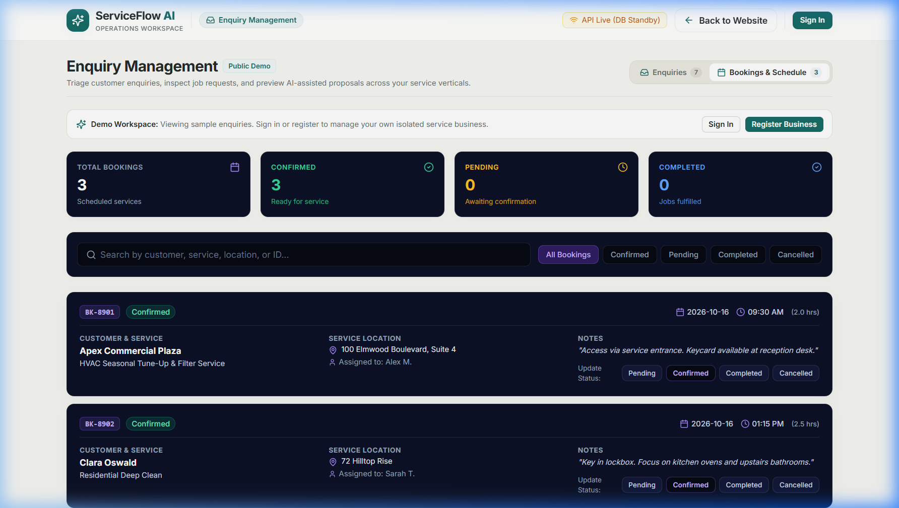
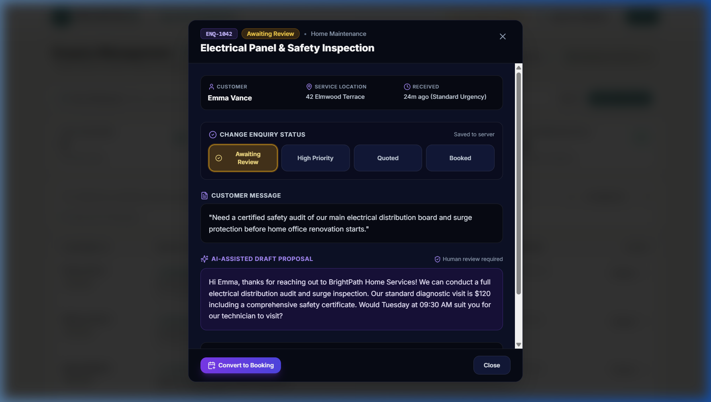
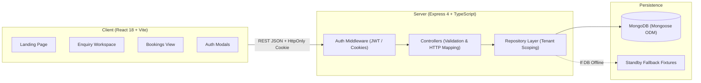

# ServiceFlow AI — Less Admin. Better Business.

An independently developed, full-stack service operations platform designed to streamline customer inquiry intake, triage, service scheduling, and tenant-isolated operations for small and independent service businesses.

[](LICENSE)
[](https://www.typescriptlang.org/)
[](https://reactjs.org/)
[](https://vitejs.dev/)
[](https://expressjs.com/)
[](https://mongoosejs.com/)
[](https://tailwindcss.com/)

[System Architecture](docs/architecture.md) • [Product Requirements](docs/requirements.md) • [GitHub Repository](https://github.com/samatha-93/serviceflow-ai)

---

## 1. Project Title

**ServiceFlow AI — Less Admin. Better Business.**

---

## 2. Project Overview

ServiceFlow AI is a portfolio-grade full-stack web application built to help small trade and service businesses organize customer communications and service delivery. It replaces scattered notebooks, text message threads, and disjointed spreadsheets with a structured workspace for triaging incoming service enquiries, scheduling bookings, tracking service status, and maintaining business-isolated customer data.

The project demonstrates full-stack architecture principles: a modern single-page frontend (React, TypeScript, Tailwind CSS), a modular REST API (Node.js, Express, TypeScript), persistent data storage with tenant isolation (MongoDB, Mongoose), and resilient fallback mechanisms for offline development.

---

## 3. Problem Statement

Small service businesses—such as residential cleaners, trade contractors, maintenance specialists, and mobile wellness operators—frequently operate without dedicated administrative staff. As a result, they face common operational friction:

- **Scattered Communication:** Inquiries arrive through phone calls, SMS, WhatsApp, and social media, making it easy for leads to be misplaced or forgotten.
- **Disconnected Scheduling:** Converting an agreed quote into a scheduled appointment often requires manual re-entry into a separate calendar tool, creating risks of double-booking or scheduling errors.
- **Administrative Fatigue:** Solo operators and small teams spend substantial evening and weekend hours replying to repetitive inquiries and following up on quotes rather than focusing on core service execution.
- **Lack of Centralized Records:** Without a unified operational ledger, tracking past customer visits, specific job notes, and service histories remains difficult.

---

## 4. Product Vision

The long-term vision of ServiceFlow AI is a continuous, intelligent operating pipeline for service professionals:

```
[Public Business Showcase]
           │
           ▼
[Customer Inquiry Intake] ──> [AI-Assisted Triage & Reply] ──> [Enquiry-to-Booking Conversion]
                                                                            │
                                                                            ▼
                                                              [Service Dispatch & CRM Ledger]
```

- **Intended Vision:** A seamless workflow starting from a public showcase and intake form, feeding into an AI copilot that categorizes urgency and generates contextual replies, transitioning approved quotes into dispatched bookings, and concluding with automated invoice generation and customer records.
- **Implemented Scope:** The project currently implements the core operational backbone: multi-tenant business authentication, centralized enquiry triage and filtering, persistent enquiry management, direct enquiry-to-booking conversion with compensating rollback, booking board management, and business profile settings and data persistence. Real LLM AI integration, public showcase pages, and invoice generation remain future roadmap milestones.

---

## 5. Target Users

ServiceFlow AI is modeled around the operational patterns of small and independent service providers:

- **Residential & Commercial Cleaning:** House cleaners, turnover specialists, and commercial janitorial contractors needing structured job specifications and recurring schedule tracking.
- **Field Service & Property Maintenance:** Facility maintenance technicians, building contractors, commercial cleaning crews, and repair operators managing recurring appointments and service dispatch clusters.
- **Home Trades & Repairs:** Handymen, plumbers, electricians, and appliance repair technicians triaging emergency requests and tracking job notes.
- **Mobile Wellness & Personal Care:** Mobile massage therapists, personal trainers, and stylists managing appointments with specific travel times.
- **Independent Professional Services:** Mobile notaries, building inspectors, and field consultants requiring structured consultation booking.

*Note: Target user categories represent modeled workflow personas; market demand has not been commercially validated.*

---

## 6. Key Features

### Implemented Features (Verified in Codebase)

- **Authentication & Multi-Tenant Data Isolation:**
  - Secure business owner registration and login using `bcryptjs` password hashing.
  - Session issuance via JSON Web Tokens (JWT) stored in secure `HttpOnly` cookies (`SameSite=strict` in production, `SameSite=lax` in development).
  - Logical data isolation: Every tenant is assigned a distinct UUID `businessId`. All database queries and writes for enquiries, bookings, and business profiles are strictly scoped to the authenticated business.
  - Guest Demo Mode: Unauthenticated visitors can explore pre-seeded sample data (`DEMO_TENANT_ID`) in a safe, read-only mode without accessing private tenant records.

- **Enquiry Management & Triage Workspace:**
  - Responsive enquiry ledger displaying customer name, contact location, service category, urgency level, status, and timestamps.
  - Multi-parameter filtering: Live text search, status filtering (`Awaiting Review`, `Quoted`, `Booked`, `Archived`), service category filtering, and urgency filtering (`Urgent`, `High`, `Standard`, `Flexible`).
  - Operational metric cards displaying counts for total inquiries, pending reviews, sent quotes, and confirmed bookings.
  - Interactive Enquiry Detail Modal: Deep inspection of customer requests, simulated AI reply suggestions, and one-click status transitions.
  - Persistent MongoDB storage with Mongoose repository abstraction.

- **Booking Management & Enquiry Conversion:**
  - Dedicated Bookings view displaying scheduled jobs, assignees, dates, times, durations, and statuses (`Confirmed`, `Pending`, `Completed`, `Cancelled`).
  - Enquiry-to-Booking Conversion Workflow: Convert any active enquiry into a confirmed service booking directly from the enquiry modal.
  - State Consistency & Compensation: Creating a booking automatically updates the associated enquiry status to `Booked`. If status synchronization fails, a compensating rollback automatically removes the newly created booking to prevent inconsistent state.
  - Duplicate Conversion Guard: Prevents converting an enquiry that has already been scheduled (returns HTTP 409 Conflict).

- **Business Profile Management & Settings:**
  - Backend models, Mongoose schemas, repositories, and REST endpoints (`GET`, `PUT`, `PATCH /api/business-profile`, `GET /api/business-profile/public/:businessId`) enforcing strict tenant scoping.
  - Interactive Business Profile settings UI (`BusinessProfileSettings.tsx`) connected via the dedicated "Business Profile" tab in the authenticated Enquiry Workspace for business owners.
  - Form validation and persistence for business identity, tagline, description, contact details (email, phone, website), operating location address, and service categories.

- **Resilient System Architecture:**
  - Database Standby Mode: The Express server boots and serves health probes and demo data even if local MongoDB is offline, reporting live connection state via headers and JSON responses.
  - Idempotent Seeders: Automated database seeders populate demo records using `bulkWrite` with `$setOnInsert` to prevent record duplication on restarts.
  - Interactive System Diagnostics modal in the frontend displaying live API response time, database status, and system metadata.

### Partially Implemented Features

- **AI-Assisted Inquiry Triage & Response:**
  - The UI displays structured AI draft suggestions, estimated durations, and urgency classification badges based on pre-calculated data and fixtures.
  - Live LLM API integration (e.g. OpenAI/Anthropic SDKs) is planned for dynamic runtime drafting.

### Planned Features

- Customer-facing public business showcase pages (consuming public profile endpoint).
- Service catalog management (custom service packages, durations, and baseline pricing).
- Dedicated Customer CRM ledger with customer history, lifetime value, and notes.
- Dynamic LLM orchestration for automated enquiry parsing and email reply generation.
- Automated email/SMS appointment reminders and follow-ups.
- Estimates, quote PDF generation, and invoicing.

---

## 7. Screenshots

> *Screenshots captured from the running application on local development server.*

### Landing Page & Value Proposition

*Modern, responsive landing page showcasing the core workflow and service verticals.*

### Enquiry Management Workspace

*Centralized triage dashboard with operational metric counters, search filters, and status badges.*

### Bookings & Scheduling Board

*Operational schedule view tracking service appointments, technician assignees, and booking statuses.*

### Enquiry Inspection & Booking Conversion

*Detailed enquiry inspection modal with AI response preview and integrated booking conversion form.*

*(If screenshot images are not yet rendered in your local environment, run the app locally following the instructions below to view the live interface).*

---

## 8. Technology Stack

### Frontend
- **Framework:** [React 18.3.1](https://reactjs.org/) (Single-Page Application)
- **Language:** [TypeScript 5.7.3](https://www.typescriptlang.org/) (Strict Mode)
- **Build Tool:** [Vite 6.0.7](https://vitejs.dev/) (Fast HMR & Optimized Bundling)
- **Styling:** [Tailwind CSS 3.4.17](https://tailwindcss.com/) with PostCSS & Autoprefixer
- **Icons:** [Lucide React 0.469.0](https://lucide.dev/)
- **Typography:** Inter (Google Fonts)

### Backend
- **Runtime:** [Node.js](https://nodejs.org/) (>= 18.0.0, LTS recommended)
- **Framework:** [Express 4.21.2](https://expressjs.com/) (RESTful API architecture)
- **Language:** [TypeScript 5.7.3](https://www.typescriptlang.org/)
- **Development Server:** [tsx 4.19.2](https://github.com/privatenumber/tsx) (Live watch mode)
- **Security & Utilities:**
  - [helmet 8.0.0](https://helmetjs.github.io/) (HTTP security headers)
  - [cors 2.8.5](https://github.com/expressjs/cors) (Origin controls)
  - [bcryptjs 3.0.3](https://github.com/dcodeIO/bcrypt.js) (Password hashing)
  - [jsonwebtoken 9.0.3](https://github.com/auth0/node-jsonwebtoken) (Stateless authentication)
  - [cookie-parser 1.4.7](https://github.com/expressjs/cookie-parser) (HttpOnly cookie parsing)
  - [dotenv 16.4.7](https://github.com/motdotla/dotenv) (Environment configuration)

### Database & Persistence
- **Database:** [MongoDB](https://www.mongodb.com/) (Document storage)
- **Object Data Modeling (ODM):** [Mongoose 8.9.5](https://mongoosejs.com/)
- **Architecture Pattern:** Repository Pattern with tenant-scoped queries and compound indexes

### Monorepo & Tooling
- **Workspaces:** Native npm workspaces (`client`, `server`)
- **Process Orchestration:** [concurrently 9.1.2](https://github.com/open-cli-tools/concurrently)

---

## 9. Architecture

The system utilizes a clean, layered client-server architecture with repository-based data access:



### Architecture Highlights:
1. **Layered Separation:** Routing, request validation, business logic, and database persistence are strictly isolated into dedicated directories (`routes`, `controllers`, `repositories`, `models`).
2. **Multi-Tenant Isolation:** All persistence methods enforce tenant constraints by accepting a `businessId` parameter. Queries prevent cross-tenant data leaks.
3. **Compensating Transactions:** Critical workflows crossing domain boundaries (such as converting an enquiry into a booking) implement programmatic compensating rollback if downstream state mutations fail.
4. **Resilient Non-Blocking Startup:** The backend initializes the HTTP listener independently of MongoDB connectivity, allowing health checks and public demonstration without a mandatory local database service.

For detailed technical design specifications, refer to [docs/architecture.md](docs/architecture.md).

---

## 10. Project Structure

```
Service-AI-Flow/
├── client/                                 # Frontend SPA Workspace
│   ├── public/                             # Static assets (favicon.svg)
│   ├── src/
│   │   ├── components/                     # Modular React Components
│   │   │   ├── auth/                       # AuthModal (Login & Registration forms)
│   │   │   ├── bookings/                   # BookingsView (Scheduled bookings list & metrics)
│   │   │   ├── business/                   # BusinessProfileSettings (Profile & location editor)
│   │   │   ├── enquiries/                  # EnquiryWorkspace, Table, Filters, Metrics, DetailModal, CreateModal
│   │   │   ├── DashboardPreview.tsx        # Interactive Product Preview section
│   │   │   ├── Features.tsx                # Feature list grid
│   │   │   ├── Navbar.tsx                  # Navigation header with auth triggers
│   │   │   └── SystemDiagnosticsModal.tsx  # Real-time backend connectivity modal
│   │   ├── data/                           # Fallback mock fixtures for client-side offline mode
│   │   ├── services/                       # API clients (auth.api.ts, enquiry.api.ts, booking.api.ts)
│   │   ├── App.tsx                         # Root component, view routing, health poll
│   │   ├── index.css                       # Tailwind root directives & design tokens
│   │   ├── main.tsx                        # React DOM mounting
│   │   └── types.ts                        # Shared frontend TypeScript interfaces
│   ├── .env.example                        # Client environment variable template
│   ├── package.json                        # Client workspace scripts & dependencies
│   ├── tailwind.config.js                  # Tailwind theme and custom color definitions
│   └── vite.config.ts                      # Vite build settings & API reverse proxy
│
├── server/                                 # Backend API Workspace
│   ├── src/
│   │   ├── config/                         # Environment parsing and MongoDB lifecycle
│   │   │   ├── database.ts                 # MongoDB connection & standby handler
│   │   │   └── env.ts                      # Validated environment configuration
│   │   ├── controllers/                    # HTTP Controllers (validation & response handling)
│   │   │   ├── auth.controller.ts          # Authentication (register, login, session, logout)
│   │   │   ├── booking.controller.ts       # Bookings CRUD & enquiry conversion
│   │   │   ├── businessProfile.controller.ts # Business profile management
│   │   │   ├── enquiry.controller.ts       # Enquiries CRUD & status transitions
│   │   │   └── health.controller.ts        # System diagnostics endpoint
│   │   ├── data/                           # Initial fixtures & idempotent database seeders
│   │   ├── middleware/                     # Express middleware
│   │   │   └── auth.middleware.ts          # requireAuth & optionalAuth JWT validators
│   │   ├── models/                         # Mongoose schemas & compound indexes
│   │   │   ├── booking.model.ts            # Booking schema
│   │   │   ├── businessProfile.model.ts    # Business profile schema
│   │   │   ├── enquiry.model.ts            # Enquiry schema
│   │   │   └── user.model.ts               # User schema with password hashing
│   │   ├── repositories/                   # Data access layer with businessId scoping
│   │   ├── routes/                         # REST endpoint declarations
│   │   ├── types/                          # Backend TypeScript types & DTO interfaces
│   │   ├── utils/                          # Cryptographic & token utilities
│   │   │   └── token.util.ts               # JWT signing, cookie configuration, verification
│   │   ├── app.ts                          # Express application configuration & security headers
│   │   └── index.ts                        # Server entry point & graceful shutdown listeners
│   ├── .env.example                        # Server environment variable template
│   ├── package.json                        # Server workspace scripts & dependencies
│   └── tsconfig.json                       # Server TypeScript compiler settings
│
├── docs/                                   # Project Documentation
│   ├── architecture.md                     # System architecture & sequence diagrams
│   └── requirements.md                     # Product requirements document (PRD)
│
├── .env.example                            # Root environment configuration guide
├── .gitignore                              # Comprehensive version control exclusions
├── LICENSE                                 # MIT License
├── package.json                            # Root monorepo configuration & concurrently scripts
└── README.md                               # Project documentation
```

---

## 11. Prerequisites

Before installing ServiceFlow AI locally, ensure you have the following installed:

- **Node.js:** v18.0.0 or higher (v20+ recommended). Check with `node -v`.
- **npm:** v9.0.0 or higher. Check with `npm -v`.
- **Git:** Check with `git --version`.
- **MongoDB (Optional for Demo Mode, Required for Multi-Tenant Auth):**
  - Local MongoDB instance running on `mongodb://localhost:27017` or a [MongoDB Atlas](https://www.mongodb.com/atlas) connection URI.
  - *Note:* If MongoDB is not running, the application starts in **standby mode**. You can browse the landing page, view demo enquiries, and inspect health status without database errors. To register private business accounts or persist mutations, an active MongoDB instance is required.

---

## 12. Local Installation

Follow these steps to run the application locally:

### 1. Clone the Repository
```bash
git clone https://github.com/samatha-93/serviceflow-ai.git
cd serviceflow-ai
```

### 2. Install Dependencies
Install all workspace dependencies from the root directory:
```bash
npm install
```

### 3. Configure Environment Variables
Copy the provided `.env.example` templates to their respective locations:

```bash
# Server environment file
cp server/.env.example server/.env

# Client environment file
cp client/.env.example client/.env
```
*(On Windows PowerShell, use `copy server\.env.example server\.env` and `copy client\.env.example client\.env`)*.

### 4. Start MongoDB (Recommended)
Ensure your local MongoDB daemon is running:
```bash
# Example for Windows Service
net start MongoDB

# Example for macOS / Linux (Homebrew)
brew services start mongodb-community
```

### 5. Start Development Servers
Run both client and server concurrently with one command from the project root:
```bash
npm run dev
```

The terminal will launch both services:
- **Client (Vite):** [http://localhost:5173](http://localhost:5173)
- **Server (Express API):** [http://localhost:5000](http://localhost:5000)
- **Health Probe:** [http://localhost:5000/api/health](http://localhost:5000/api/health)

### 6. Verify Static Types & Production Build
To verify codebase integrity and build artifacts:
```bash
# Run TypeScript compilation checks across client and server
npm run type-check

# Compile production bundles for client (Vite) and server (tsc)
npm run build
```

---

## 13. Environment Configuration

ServiceFlow AI enforces a strict zero-secrets policy. All configuration parameters are managed via environment variables and documented through templates. Actual credentials and keys must never be committed to source control.

### Server Configuration (`server/.env`)
| Variable | Description | Default in Dev |
|---|---|---|
| `PORT` | Port for the Express REST API server | `5000` |
| `NODE_ENV` | Runtime environment (`development`, `production`, `test`) | `development` |
| `CLIENT_ORIGINS` | Comma-separated exact frontend origins allowed for credentialed browser requests (legacy `CLIENT_ORIGIN` is accepted when this is unset) | `http://localhost:5173` in development; configure explicitly in production |
| `AUTH_RATE_LIMIT_MAX` | Maximum combined login and registration attempts per client in each window | `10` |
| `AUTH_RATE_LIMIT_WINDOW_MS` | Authentication rate-limit window in milliseconds | `900000` (15 minutes) |
| `MONGODB_URI` | MongoDB connection string | `mongodb://localhost:27017/serviceflow-ai` |
| `JWT_SECRET` | Secret key used for signing session JWTs (minimum 32 characters) | *Set your secure local string* |
| `JWT_EXPIRES_IN` | Token expiration duration | `7d` |

### Client Configuration (`client/.env`)
| Variable | Description | Default in Dev |
|---|---|---|
| `VITE_API_URL` | Base path or URL for API requests (proxied by Vite in dev) | `/api` |

---

## 14. API Overview

All API endpoints are prefixed with `/api` and return standardized JSON envelopes:

### System & Health
| Method | Endpoint | Auth Required | Description |
|---|---|---|---|
| `GET` | `/api/health` | No | Returns process uptime, environment, timestamp, and live MongoDB status. |

### Authentication (`/api/auth`)
| Method | Endpoint | Auth Required | Description |
|---|---|---|---|
| `POST` | `/api/auth/register` | No | Registers a new business owner, assigns a unique `businessId`, and sets an `HttpOnly` cookie. |
| `POST` | `/api/auth/login` | No | Authenticates business owner credentials and sets an `HttpOnly` session cookie. |
| `GET` | `/api/auth/me` | Yes (`requireAuth`) | Returns the authenticated user's profile and tenant identifier. |
| `POST` | `/api/auth/logout` | No | Clears the authentication session cookie. |

### Enquiries (`/api/enquiries`)
| Method | Endpoint | Auth Required | Description |
|---|---|---|---|
| `GET` | `/api/enquiries` | Optional (`optionalAuth`) | Returns enquiries scoped to the caller's `businessId`, or public demo data if unauthenticated. |
| `GET` | `/api/enquiries/:id` | Optional (`optionalAuth`) | Retrieves a single enquiry by ID with tenant ownership verification. |
| `POST` | `/api/enquiries` | Yes (`requireAuth`) | Creates a new enquiry stamped with the authenticated business's `businessId`. |
| `PATCH` | `/api/enquiries/:id/status` | Yes (`requireAuth`) | Updates an enquiry's status with tenant ownership validation. |

### Bookings (`/api/bookings`)
| Method | Endpoint | Auth Required | Description |
|---|---|---|---|
| `GET` | `/api/bookings` | Optional (`optionalAuth`) | Returns bookings scoped to the caller's `businessId`, or public demo data if unauthenticated. |
| `GET` | `/api/bookings/:id` | Optional (`optionalAuth`) | Retrieves a single booking by ID with tenant ownership verification. |
| `POST` | `/api/bookings` | Yes (`requireAuth`) | Creates a booking. If `enquiryId` is passed, converts enquiry to `Booked` with compensating rollback on error. |
| `PATCH` | `/api/bookings/:id/status` | Yes (`requireAuth`) | Updates a booking's status with tenant ownership validation. |

### Business Profile (`/api/business-profile`)
| Method | Endpoint | Auth Required | Description |
|---|---|---|---|
| `GET` | `/api/business-profile` | Optional (`optionalAuth`) | Retrieves business profile for the authenticated tenant or demo tenant. |
| `GET` | `/api/business-profile/public/:businessId` | No | Public showcase profile endpoint for any valid `businessId`. |
| `PUT` | `/api/business-profile` | Yes (`requireAuth`) | Full update of business profile details scoped to the caller's `businessId`. |
| `PATCH` | `/api/business-profile` | Yes (`requireAuth`) | Partial update of business profile details scoped to the caller's `businessId`. |

---

## 15. Authentication and Security

Implemented security controls:

- **Password Protection:** User passwords are never stored in plaintext. Passwords are salted and hashed using `bcryptjs` with 10 salt rounds prior to persistence.
- **Session Security:** Sessions are maintained via JSON Web Tokens signed with HMAC SHA-256. Tokens are transmitted in `HttpOnly` cookies (`SameSite=strict` in production environments, `SameSite=lax` in local development) to protect against client-side script extraction (XSS).
- **Tenant Isolation:** The API middleware validates the JWT and injects `req.user` into the request lifecycle. All persistent operations enforce `{ businessId: req.user.businessId }`, preventing horizontal privilege escalation across tenants.
- **HTTP Header Hardening:** `helmet` is configured to set defensive HTTP headers, disabling MIME sniffing, restricting framing (anti-clickjacking), and sanitizing referrer data.
- **CORS and Origin Validation:** Credentialed browser requests are allowlisted by exact `CLIENT_ORIGINS`. Mutating requests require an allowed `Origin`, except no-Origin Bearer-authenticated API clients. Cookie-authenticated mutations with missing, `null`, malformed, or untrusted origins are rejected; CORS alone is not treated as CSRF protection. Non-browser requests without an Origin remain available for health checks and supported API clients.
- **Authentication Throttling:** Login and registration share a configurable in-memory per-IP limit. Limits reset when the server restarts and should be backed by a shared store for multi-instance deployments.
- **Payload Validation:** All controller handlers enforce payload type checks, field length limits, format regex validation (such as calendar date format `YYYY-MM-DD` and email structures), and payload size limits (`1mb`).

*Disclaimer: This project was developed as a technical portfolio project and has not undergone an external third-party security audit or compliance certification (e.g., SOC2, PCI-DSS).*

---

## 16. Testing and Verification

### Static Verification & Compilation
The repository uses strict TypeScript configurations for verification without runtime overhead:

```bash
# Type-check both client and server packages
npm run type-check

# Compile production bundles for client and server
npm run build
```
- Both commands execute with zero errors across the monorepo workspaces.

### Manual Verification
The following operational flows have been manually verified:
1. **Server Standby & Recovery:** Express boots cleanly and responds to `/api/health` even if MongoDB is offline. When MongoDB is started, seeders initialize demo fixtures and report connection status.
2. **Tenant Registration & Cookie Authentication:** Creating a new user via `/api/auth/register` creates a user document, hashes the password, issues an `HttpOnly` cookie, and establishes tenant isolation.
3. **Enquiry Management:** Inspecting, filtering, searching, and updating enquiry statuses across categories and urgency tiers.
4. **Enquiry Conversion:** Converting an enquiry to a booking persists a new booking, updates the enquiry status to `Booked`, and prevents duplicate re-conversion (409 Conflict).

*Note: Dedicated automated unit/integration test suites (e.g. Vitest, Supertest) are planned for an upcoming milestone and are not currently configured in package scripts.*

---

## 17. Current Limitations

To provide transparent technical documentation:

1. **Public Business Showcase:** While the business profile settings UI is implemented in the workspace and the backend provides public profile endpoints, customer-facing public showcase pages have not yet been built.
2. **Heuristic AI Suggestions:** The reply drafts and urgency classification displayed in the enquiry view currently rely on template heuristics and mock data rather than live LLM API calls.
3. **Customer Directory Table:** The database maintains customer records via bookings and enquiries, but a standalone CRM screen dedicated to editing customer contact cards has not yet been created.
4. **Guest Mode Persistence:** Unauthenticated guest visitors interact with demo records in client memory; status mutations performed in guest mode do not persist to MongoDB.
5. **No Automated Test Runner:** While static type-checking and production builds pass cleanly, an automated test runner (such as Jest or Vitest) is not yet integrated into CI.

---

## 18. Roadmap

Future development milestones for ServiceFlow AI include:

- [x] **Business Profile Settings:** Interactive settings view in the workspace for managing business contact info, operating locations, and services.
- [ ] **Public Business Showcase:** Customer-facing landing page where clients can view services and submit inquiries directly into the business's inbox.
- [ ] **Service Catalog Management:** Interface for configuring service offerings, base pricing, required durations, and schedule buffers.
- [ ] **Dedicated Customer CRM:** Searchable customer directory with lifetime service history, total revenue, and internal notes.
- [ ] **Live LLM Integration:** Integration with LLM APIs for dynamic inquiry summarization, sentiment extraction, and automated quote drafting.
- [ ] **Secure Business Media Uploads:** Object storage integration (e.g., S3/Cloudinary) for company logos and job site photo attachments.
- [ ] **Automated Reminders:** Configurable email/SMS triggers for appointment reminders and quote follow-ups.
- [ ] **Business Analytics:** Revenue reporting, completion rates, and inquiry-to-booking conversion analytics.
- [ ] **Automated Test Suite:** Integration of Vitest for unit tests and Supertest for API integration testing.

---

## 19. Contributing

This project is an independently developed portfolio project created to demonstrate full-stack software engineering practices, system design, and clean architecture.

While external pull requests are not actively solicited at this stage, feedback, suggestions, and architectural discussions are welcome. Please open an issue on the [GitHub repository](https://github.com/samatha-93/serviceflow-ai/issues) with any questions or observations.

---

## 20. Author

**Samatha Reddy**  
- **GitHub:** [@samatha-93](https://github.com/samatha-93)  
- **Repository:** [https://github.com/samatha-93/serviceflow-ai](https://github.com/samatha-93/serviceflow-ai)

*ServiceFlow AI is an independently developed portfolio project engineered to demonstrate modern full-stack development, multi-tenant system architecture, and clean documentation.*
