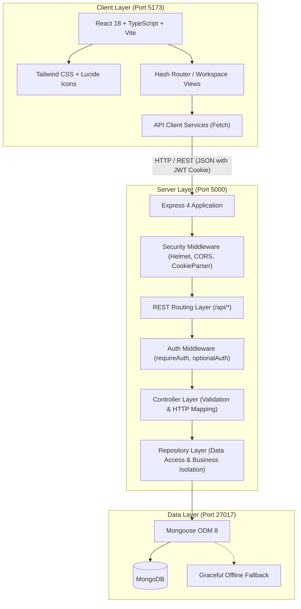
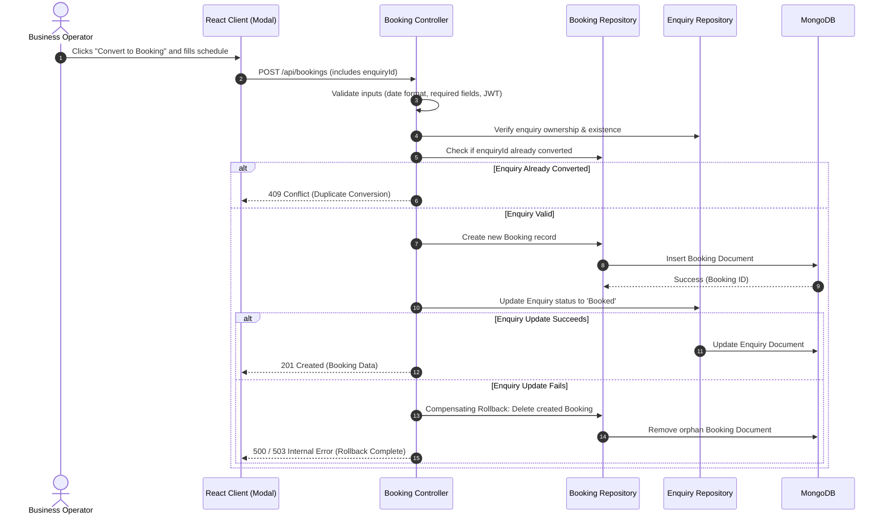

# ServiceFlow AI — System Architecture & Technical Design

> **Tagline:** Less Admin. Better Business.  
> **Repository:** [https://github.com/samatha-93/serviceflow-ai](https://github.com/samatha-93/serviceflow-ai)  
> **Status:** Active Development (Core Operations Implemented)  
> **Author:** Samatha Reddy

---

## 1. System Topology Overview

ServiceFlow AI is architected as a modular TypeScript monorepo utilizing npm workspaces. The system decouples client-side presentation from backend RESTful business logic and persistence layers.



---

## 2. Directory Structure

```
Service-AI-Flow/
├── client/                                 # Frontend SPA Workspace
│   ├── public/                             # Static assets (favicon.svg)
│   ├── src/
│   │   ├── components/                     # Modular React Components
│   │   │   ├── auth/                       # Authentication Modals (Login, Register)
│   │   │   ├── bookings/                   # Bookings Board & Schedule View
│   │   │   ├── enquiries/                  # Enquiry Workspace, Filters, Metrics, Detail Modal
│   │   │   ├── DashboardPreview.tsx        # Interactive Product Preview
│   │   │   ├── Features.tsx                # Feature Highlights
│   │   │   ├── Navbar.tsx                  # Navigation & Session Bar
│   │   │   └── SystemDiagnosticsModal.tsx  # API/DB Health Probe Modal
│   │   ├── data/                           # Client-side Demo Data Fallbacks
│   │   ├── services/                       # API Client Services (auth, enquiry, booking)
│   │   ├── App.tsx                         # Primary Application Shell & View Orchestration
│   │   ├── index.css                       # Tailwind Directives & Custom Color Tokens
│   │   ├── main.tsx                        # DOM Bootstrap
│   │   └── types.ts                        # Client-side TypeScript Interfaces
│   ├── package.json                        # Frontend Dependencies & Scripts
│   ├── tailwind.config.js                  # Design System Tokens
│   └── vite.config.ts                      # Vite Configuration & /api Reverse Proxy
│
├── server/                                 # Backend REST API Workspace
│   ├── src/
│   │   ├── config/                         # Configuration & Database Lifecycle
│   │   │   ├── database.ts                 # MongoDB / Mongoose Connection & Standby Logic
│   │   │   └── env.ts                      # Strongly-typed Environment Settings
│   │   ├── controllers/                    # Request Validation & HTTP Handlers
│   │   │   ├── auth.controller.ts          # Register, Login, Session, Logout Handlers
│   │   │   ├── booking.controller.ts       # Booking Retrieval, Creation & Status Handlers
│   │   │   ├── businessProfile.controller.ts # Business Profile Management Handlers
│   │   │   ├── enquiry.controller.ts       # Enquiry Listing, Inspection & Status Handlers
│   │   │   └── health.controller.ts        # System & Database Health Probe
│   │   ├── data/                           # Idempotent Seed Data & Initial Fixtures
│   │   │   ├── mockBookings.ts             # Initial Demo Bookings
│   │   │   ├── mockBusinessProfile.ts      # Initial Demo Business Profile
│   │   │   ├── mockEnquiries.ts            # Initial Demo Enquiries
│   │   │   └── seed.ts                     # Controlled MongoDB Upsert Seeders
│   │   ├── middleware/                     # Express Middleware
│   │   │   └── auth.middleware.ts          # requireAuth & optionalAuth JWT Interceptors
│   │   ├── models/                         # Mongoose Schemas & Schema Validation
│   │   │   ├── booking.model.ts            # Booking Schema & Compound Indexes
│   │   │   ├── businessProfile.model.ts    # Business Profile Schema
│   │   │   ├── enquiry.model.ts            # Enquiry Schema & Indexes
│   │   │   └── user.model.ts               # User Schema & Password Salt Hash
│   │   ├── repositories/                   # Data Access Abstraction Layer
│   │   │   ├── booking.repository.ts       # Booking Persistence & Tenant Scoping
│   │   │   ├── businessProfile.repository.ts # Profile Persistence & Scoping
│   │   │   ├── enquiry.repository.ts       # Enquiry Persistence & Scoping
│   │   │   └── user.repository.ts          # User Query & Registration
│   │   ├── routes/                         # Express Route Definitions
│   │   │   ├── auth.routes.ts              # /api/auth Endpoints
│   │   │   ├── booking.routes.ts           # /api/bookings Endpoints
│   │   │   ├── businessProfile.routes.ts   # /api/business-profile Endpoints
│   │   │   ├── enquiry.routes.ts           # /api/enquiries Endpoints
│   │   │   ├── health.routes.ts            # /api/health Endpoint
│   │   │   └── index.ts                    # Consolidated API Router
│   │   ├── types/                          # Backend TypeScript Type Definitions
│   │   ├── utils/                          # Cryptographic & Token Utilities
│   │   │   └── token.util.ts               # JWT Signing, Cookie Setting, Token Verification
│   │   ├── app.ts                          # Express Application Middleware Setup
│   │   └── index.ts                        # HTTP Server Entry Point & Process Handlers
│   ├── package.json                        # Server Dependencies & Scripts
│   └── tsconfig.json                       # Server TypeScript Configuration
│
├── docs/                                   # Project Documentation
│   ├── architecture.md                     # Technical Architecture & Design
│   └── requirements.md                     # Product Requirements Document
│
├── .env.example                            # Root Environment Variable Template
├── package.json                            # Monorepo Workspace Configuration
└── README.md                               # Repository Documentation
```

---

## 3. Data Isolation & Multi-Tenancy Architecture

ServiceFlow AI implements **logical tenant isolation** to guarantee that registered businesses cannot access or manipulate other businesses' operational records:

1. **Unique Business Identifier:** When a user registers an account, a distinct UUID v4 `businessId` is generated and assigned to that business account.
2. **JWT Claims:** The issued JSON Web Token encapsulates `{ userId, businessId, email, role }`.
3. **Cookie Authentication:** The token is stored in an `HttpOnly`, `SameSite=lax` cookie (`sf_auth_token`), preventing cross-site scripting (XSS) extraction.
4. **Scoped Repositories:** All data access methods in `bookingRepository`, `enquiryRepository`, and `businessProfileRepository` mandate tenant scoping:
   - Queries automatically filter by `{ businessId: callerBusinessId }`.
   - Mutation operations (`create`, `updateStatus`, `deleteById`) explicitly verify business ownership before modifying records.
5. **Database Indexing:** Compound indexes are applied at the database level:
   - Bookings: `{ businessId: 1, id: 1 }` and `{ businessId: 1, enquiryId: 1 }`
   - Enquiries: `{ businessId: 1, id: 1 }`
   - Business Profile: `{ businessId: 1 }` (unique)
6. **Public Demo Isolation:** Unauthenticated requests map to a shared constant `DEMO_TENANT_ID`. Read operations return demo data, while write operations require authentication or apply locally in client memory only.

---

## 4. Enquiry-to-Booking State Machine & Compensation

Converting an incoming enquiry into a confirmed service appointment requires coordinating state across two distinct domain models:



This pattern ensures that a failure in the second operation does not leave orphan bookings or inconsistent enquiry states.

---

## 5. Graceful Standby & Database Resilience

To facilitate seamless local development and portfolio demonstration:
- **Non-blocking Initialization:** The backend Express server initiates MongoDB connection asynchronously without blocking the server listener.
- **Standby Mode:** If MongoDB is offline or unreachable, the server continues running in `standby` mode rather than crashing.
- **Diagnostic Endpoint:** `GET /api/health` exposes system uptime, memory usage, environment, and real-time database connection state (`connected`, `connecting`, `disconnected`).
- **Idempotent Seeding:** On successful database connection, controlled seeders use `bulkWrite` with `$setOnInsert` to populate demo data without duplicating records across server restarts.

---

## 6. Security Baseline

- **Password Storage:** Salted and hashed using `bcryptjs` (salt rounds: 10).
- **Session Tokens:** Signed with HMAC SHA-256 (`jsonwebtoken`), protected by `HttpOnly` and `SameSite` cookies with configurable expiration.
- **HTTP Headers:** Configured with `helmet` to mitigate cross-site scripting, MIME sniffing, and clickjacking.
- **CORS and CSRF Protection:** Credentialed browser requests use the exact configured `CLIENT_ORIGINS` allowlist. Mutating requests validate Origin independently of CORS; cookie-authenticated requests require an allowed Origin, while no-Origin Bearer clients remain supported. Missing Origin with a cookie, `null`, malformed, and untrusted origins are rejected. Non-browser requests without Origin remain available. This origin policy does not replace broader CSRF review for future authentication flows.
- **Authentication Throttling:** Login and registration share a configurable in-memory per-IP fixed-window limit; multi-instance deployments need a shared rate-limit store for consistent enforcement.
- **Request Size Limits:** JSON bodies are limited to 1 MB and URL-encoded bodies to 100 KB; oversized bodies receive HTTP 413.
- **Input Sanitization:** Controllers validate payload schemas, string lengths, date formats, and enumerated status strings prior to repository execution.
